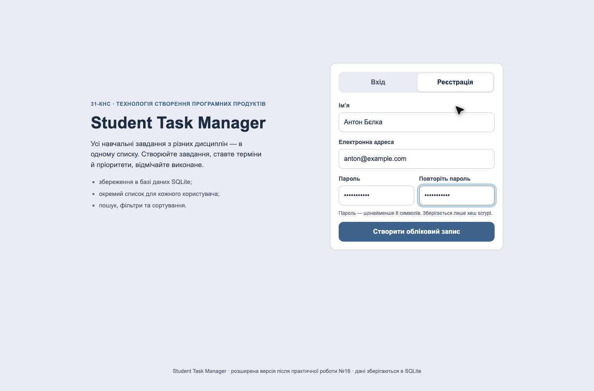
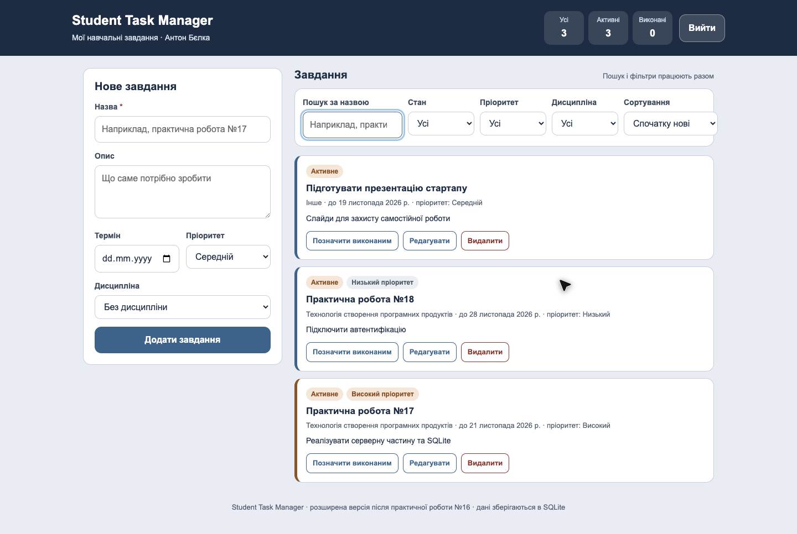
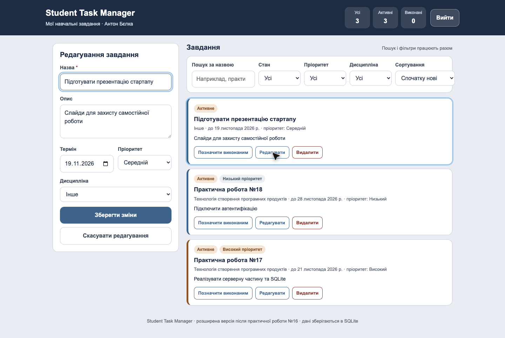
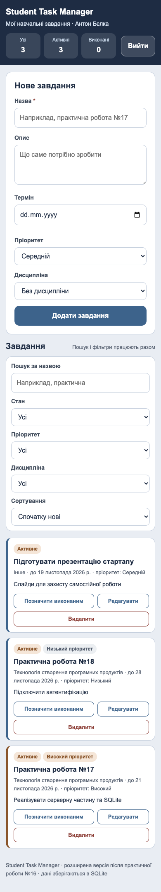
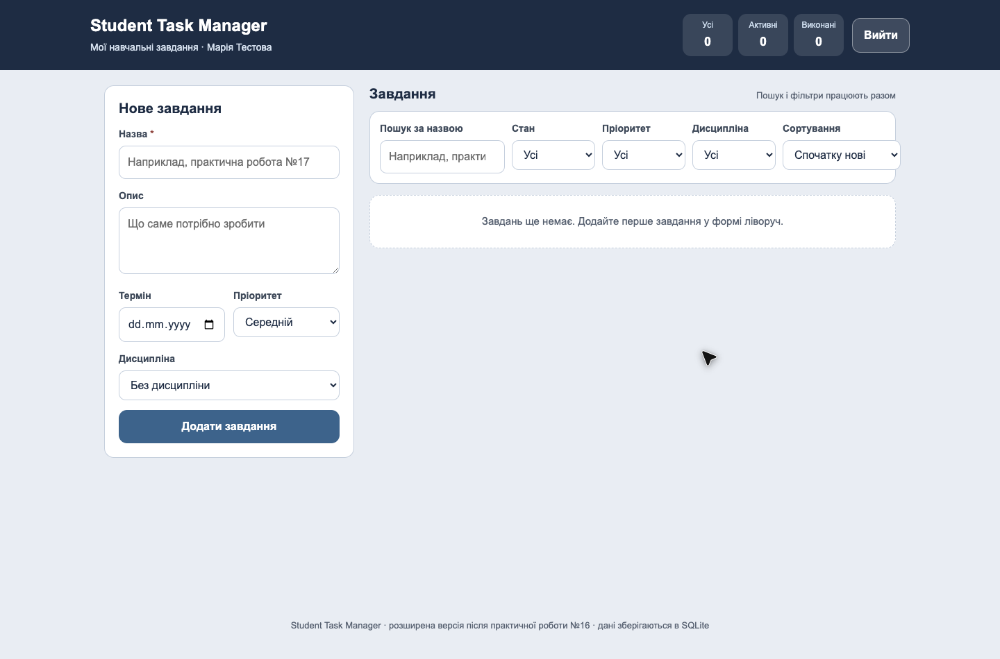

# Student Task Manager

Student Task Manager — навчальний вебзастосунок, який збирає завдання студента з різних дисциплін в одному списку. Кожен користувач має власний обліковий запис і бачить лише свої записи: назву, дисципліну, термін, пріоритет, опис і стан виконання.

Проєкт створено для дисципліни «Технологія створення програмних продуктів» (31-КНС): практична робота №16 дала статичний MVP, самостійна робота — завершену версію із сервером, базою даних і обліковими записами.

## Статус проєкту

Поточна версія — **завершена версія після самостійної роботи** (`server/`): реєстрація, вхід, вихід, створення, перегляд, редагування, видалення та зміна стану завдань, пошук, фільтри й сортування, збереження даних у SQLite. Статична версія практичної роботи №16 (`app/`) залишена для історії та не потребує сервера.

## Функції

- реєстрація (ім’я, унікальна електронна адреса, пароль і підтвердження) та вхід;
- вихід із завершенням сесії;
- створення завдання з назвою, описом, терміном, пріоритетом і дисципліною;
- перегляд списку з підписами, бейджами стану й пріоритету та позначкою «Прострочено»;
- редагування всіх полів вибраного завдання без створення дубліката;
- позначення виконаним і повернення до активних;
- видалення саме вибраного завдання;
- пошук за назвою, фільтри за станом, пріоритетом і дисципліною, сортування за терміном, пріоритетом, назвою та датою створення; пошук і фільтри працюють разом;
- лічильники всіх, активних і виконаних завдань;
- стани інтерфейсу: завантаження, порожній список, «нічого не знайдено», помилки полів, недоступний сервер;
- адаптивне відображення для вузького екрана й робота з клавіатури з видимим фокусом.

## Використані технології

- **Node.js 22.5+** — серверна частина на вбудованому модулі `node:http` без фреймворків;
- **SQLite** через вбудований модуль `node:sqlite` (`DatabaseSync`), файл бази `server/data/task-manager.db`;
- **scrypt** (`node:crypto`) для хешування паролів, `HttpOnly`-cookie для сесій;
- **HTML5, CSS3, JavaScript (ES2020)** — інтерфейс без збирачів і зовнішніх бібліотек;
- **node:test** — інтеграційні тести API;
- **Git і GitHub** — контроль версій і публікація репозиторію.

Зовнішніх залежностей немає: `npm install` не завантажує пакетів.

## Вимоги до середовища

- Node.js **22.5 або новіший** (потрібен модуль `node:sqlite`);
- npm (постачається разом із Node.js);
- сучасний браузер: Google Chrome, Mozilla Firefox, Microsoft Edge або Safari;
- операційна система: Windows, macOS або Linux.

## Установлення залежностей

```bash
git clone https://github.com/abc2cb/student-task-manager.git
cd student-task-manager/server
npm install
```

`npm install` створює службові файли npm; зовнішніх бібліотек проєкт не використовує.

## Налаштування та створення бази даних

База створюється SQL-скриптом [`server/db/schema.sql`](server/db/schema.sql):

```bash
cd server
npm run init-db
```

Команда створює файл `server/data/task-manager.db`, таблиці `users`, `sessions`, `categories`, `tasks` та заповнює довідник дисциплін. Повторний запуск нічого не дублює (`CREATE TABLE IF NOT EXISTS`, `INSERT OR IGNORE`).

Щоб створити базу в іншому місці, задайте `DB_PATH`:

```bash
DB_PATH=/шлях/до/task-manager.db npm run init-db
```

## Змінні середовища

Приклад — [`server/.env.example`](server/.env.example):

```dotenv
PORT=3000
DB_PATH=./data/task-manager.db
```

Файл `.env` не обов’язковий: без нього використовуються значення за замовчуванням (`PORT=3000`, `server/data/task-manager.db`). Справжні паролі й секрети в репозиторій не додаються.

## Запуск

```bash
cd server
npm start
```

Після запуску відкрийте <http://127.0.0.1:3000>. У консолі буде надруковано адресу та шлях до файлу бази. Зупинка — `Ctrl+C`.

Запуск із іншим портом:

```bash
PORT=8080 npm start
```

## Структура проєкту

```text
app/                 статичний MVP практичної роботи №16 (історія)
prototype/           клікабельний прототип
docs/                вимоги, діаграми, опис MVP і результати перевірок
server/
  app.js             HTTP-сервер, маршрути API, валідація
  db.js              підключення до SQLite та підготовлені запити
  lib/security.js    хешування паролів scrypt і створення сесій
  db/schema.sql      SQL-скрипт створення бази
  db/init-db.js      команда npm run init-db
  public/            інтерфейс: index.html, styles.css, app.js
  test/api.test.js   інтеграційні тести API
```

## Основний сценарій

1. Відкрийте <http://127.0.0.1:3000>, перейдіть на вкладку «Реєстрація» й створіть обліковий запис.
2. Заповніть назву, опис, термін, пріоритет і дисципліну та натисніть «Додати завдання».
3. Натисніть «Редагувати», змініть поля й збережіть — кількість записів не зміниться.
4. Натисніть «Позначити виконаним», потім «Повернути до активних».
5. Скористайтеся пошуком, фільтрами та сортуванням — вони діють разом.
6. Натисніть «Видалити» — зі списку зникне саме вибраний запис.

## Демонстрація з двома користувачами

1. Зареєструйте першого користувача (наприклад, `anton@example.com`) і створіть 2–3 завдання.
2. Натисніть «Вийти», зареєструйте другого користувача (`maria@example.com`) — його список порожній.
3. Спробуйте відкрити чуже завдання прямим запитом `DELETE /api/tasks/<id>` від імені другого користувача — сервер поверне `404`.
4. Вийдіть і ввійдіть першим користувачем — його завдання на місці.

## Скриншоти

| Екран входу й реєстрації | Основний екран |
| --- | --- |
|  |  |

| Створення й редагування | Вузький екран | Другий користувач |
| --- | --- | --- |
|  |  |  |

## Результати перевірок

- [docs/mvp.md](docs/mvp.md) — межі версій, структура бази, захист даних, виявлені й виправлені дефекти, **17 перевірок** з очікуваним і фактичним результатом (розділ 7).
- Автоматичні тести: `cd server && npm test` — 12 інтеграційних тестів API (реєстрація, вхід, вихід, CRUD, пошук і фільтри, ізоляція користувачів, збереження після перезапуску).

## Відомі обмеження

- застосунок розрахований на локальний запуск; публічного хостингу немає;
- немає відновлення пароля та підтвердження електронної пошти;
- немає окремого інтерфейсу керування дисциплінами — довідник задається SQL-скриптом;
- немає CSRF-токена: захист спирається на `SameSite=Lax` і перевірку сесії на сервері;
- немає спільного доступу до завдань, синхронізації в реальному часі та нагадувань;
- немає завантаження файлів до завдань.

## Документація

- [MVP: межі, обмеження та результати перевірок](docs/mvp.md)
- [Опис продукту](docs/product-description.md)
- [Вимоги до продукту](docs/requirements.md)
- [Перевірка вимог](docs/requirements-review.md)
- [User stories](docs/user-stories.md)
- [Use-case діаграма](docs/use-case.md)
- [Activity-діаграма](docs/activity-diagram.md)
- [Class-діаграма](docs/class-diagram.md)
- [Ескізи екранів](docs/screen-sketches.md)
- [Опис прототипу](docs/prototype.md)

## Прототип

Клікабельний прототип — [prototype/index.html](prototype/index.html), відкривається у браузері без сервера. Робоча версія `server/public/` повторює структуру екранів прототипу та використовує ті самі кольори й підписи. Figma свідомо не використовувалась: вебзастосунок працював нестабільно, тому прототип виконано локально.

## Автор

Бєлка Антон Андрійович, група 31-КНС. Профіль GitHub: [abc2cb](https://github.com/abc2cb).

## Навчальна дисципліна

Технологія створення програмних продуктів, практична робота № 16 і самостійна робота «Розроблення завершеної версії програмного продукту на основі MVP».
