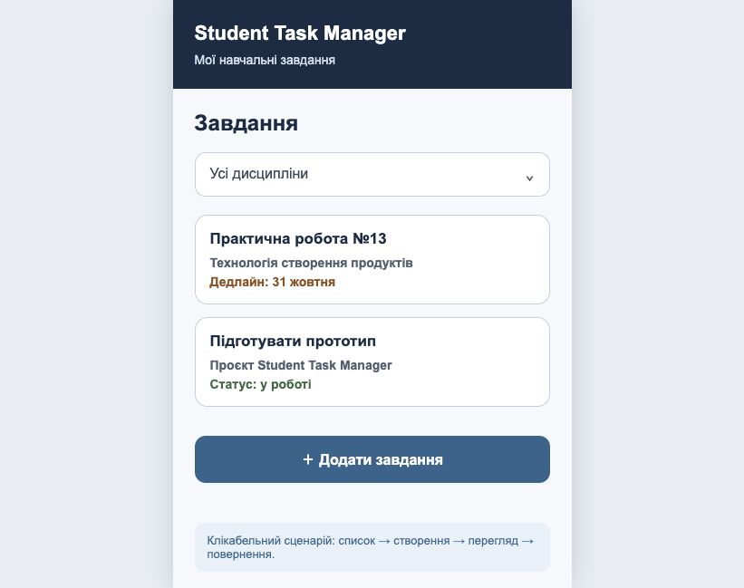

# Student Task Manager

Student Task Manager — навчальний вебзастосунок для студента, який збирає навчальні завдання з кількох дисциплін в одному списку. Продукт призначений для студентів коледжу, які виконують роботи з різних предметів і хочуть бачити назву завдання, дисципліну, дедлайн і статус виконання в одному місці, а не в чатах, документах і нотатках.

## Статус проєкту

Навчальна версія MVP: реалізовано клікабельний прототип основного сценарію «список → створення → перегляд → зміна статусу». Дані поки не зберігаються: прототип демонструє екрани й переходи, а не повний облік завдань.

## Основні функції

- перегляд списку завдань із назвою, дисципліною, дедлайном і статусом;
- перехід до форми створення завдання та заповнення полів «назва», «дисципліна», «дедлайн», «пріоритет», «опис»;
- перехід до екрана перегляду завдання після натискання «Зберегти»;
- зміна статусу завдання з «У роботі» на «Виконано» на екрані перегляду;
- повернення до списку та скасування створення;
- прямі посилання на екрани через адресу: `#list`, `#create`, `#details`.

## Використані технології

- HTML5 — структура трьох екранів;
- CSS3 — оформлення інтерфейсу без зовнішніх бібліотек;
- JavaScript — перемикання екранів, обробка кнопок, зміна статусу;
- Git і GitHub — контроль версій і публікація репозиторію.

## Вимоги до запуску

Потрібен сучасний браузер: Google Chrome, Mozilla Firefox, Microsoft Edge або Safari. Сервер, Node.js і база даних не потрібні. Для клонування репозиторію потрібен Git.

## Отримання проєкту

```bash
git clone https://github.com/abc2cb/student-task-manager.git
cd student-task-manager
```

## Установлення залежностей

Установлення додаткових залежностей не потрібне: проєкт не має `package.json` і не використовує npm.

## Запуск

Відкрийте файл `prototype/index.html` у браузері — подвійним кліком у файловому менеджері або командою в терміналі:

```bash
open prototype/index.html
```

У Windows замість `open` використовуйте `start prototype/index.html`.

За потреби прототип можна відкрити через локальний сервер:

```bash
python3 -m http.server 8000
```

Після запуску відкрийте в браузері адресу `http://localhost:8000/prototype/index.html`. Головний екран — список завдань. Щоб зупинити сервер, натисніть `Ctrl+C`.

## Приклад використання

1. Відкрийте `prototype/index.html` — з'явиться екран «Завдання» зі списком.
2. Натисніть «＋ Додати завдання».
3. Заповніть назву, дисципліну, дедлайн, пріоритет і опис.
4. Натисніть «Зберегти» — відкриється екран «Деталі завдання».
5. Натисніть «Позначити виконаним» — статус зміниться на «Виконано».
6. Натисніть «Повернутися до списку», щоб повернутися на головний екран.

## Вигляд продукту



## Документація

- [Опис продукту](docs/product-description.md)
- [Вимоги до продукту](docs/requirements.md)
- [Перевірка вимог](docs/requirements-review.md)
- [User stories](docs/user-stories.md)
- [Use-case діаграма](docs/use-case.md)
- [Activity-діаграма](docs/activity-diagram.md)
- [Class-діаграма](docs/class-diagram.md)
- [Ескізи екранів](docs/screen-sketches.md)
- [Опис прототипу](docs/prototype.md)

## Прототип

- [Клікабельний прототип у браузері](prototype/index.html) — локальний файл, працює без сервера.
- Figma-версія прототипу ще не опублікована: екрани підготовлені як SVG-ескізи в [docs/images](docs/images) і можуть бути перенесені у Figma без зміни макета.

## Відомі обмеження

- дані не зберігаються: після перезавантаження сторінки введені значення зникають;
- створене завдання не додається до списку — екран перегляду показує демонстраційний запис;
- редагування, видалення, фільтрування й сортування не реалізовані;
- немає реєстрації користувачів і синхронізації між пристроями.

## Можливі покращення

- збереження завдань у `localStorage`;
- додавання нового запису до списку після збереження;
- редагування та видалення завдань;
- фільтрування за дисципліною й статусом, сортування за дедлайном;
- публікація клікабельної Figma-версії прототипу.

## Автор

Бєлка Антон Андрійович, група 31-КНС. Профіль GitHub: [abc2cb](https://github.com/abc2cb).

## Навчальна дисципліна

Технологія створення програмних продуктів, практична робота № 15.
