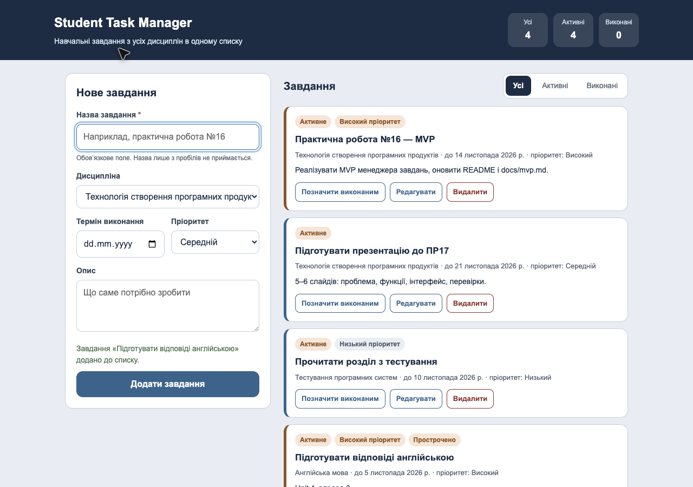

# Student Task Manager

Student Task Manager — навчальний вебзастосунок для студента, який збирає навчальні завдання з кількох дисциплін в одному списку. Продукт призначений для студентів коледжу, які виконують роботи з різних предметів і хочуть бачити назву завдання, дисципліну, дедлайн і статус виконання в одному місці, а не в чатах, документах і нотатках.

## Статус проєкту

Поточна версія — **робочий MVP** практичної роботи №16. Реалізовано створення, перегляд, редагування, видалення завдань, зміну стану та фільтрацію списку. Дані зберігаються в пам’яті сторінки: після перезавантаження список порожній. Реєстрації користувачів, серверної частини та бази даних у цій версії немає.

## Основні функції

- перегляд списку завдань із назвою, дисципліною, терміном виконання, пріоритетом і станом;
- створення завдання з перевіркою обов’язкової назви;
- редагування вибраного завдання без створення дубліката;
- позначення завдання виконаним і повернення його до активних;
- видалення саме вибраного завдання;
- фільтр «Усі / Активні / Виконані» з окремим повідомленням, якщо за вибраним фільтром записів немає;
- підказки про порожній список, прострочені завдання та результат кожної дії;
- лічильники всіх, активних і виконаних завдань;
- адаптивне відображення для вузького екрана.

## Використані технології

- HTML5 — структура сторінки та семантичні елементи форм;
- CSS3 — оформлення, сітка, адаптивні медіазапити, видимий фокус;
- JavaScript (ES2020) — масив завдань у пам’яті, рендеринг списку через DOM API, валідація назви;
- Git і GitHub — контроль версій і публікація репозиторію.

Зовнішні бібліотеки, фреймворки, збирачі та сервер не використовуються.

## Вимоги до середовища

Сучасний браузер: Google Chrome, Mozilla Firefox, Microsoft Edge або Safari. Node.js, npm і база даних не потрібні. Для клонування репозиторію потрібен Git.

## Отримання проєкту

```bash
git clone https://github.com/abc2cb/student-task-manager.git
cd student-task-manager
```

## Установлення залежностей

Установлення залежностей не потрібне: у проєкті немає `package.json`, зовнішніх бібліотек і етапу збирання.

## Запуск

Відкрийте файл `app/index.html` у браузері — подвійним кліком у файловому менеджері або командою в терміналі:

```bash
open app/index.html
```

У Windows замість `open` використовуйте `start app/index.html`.

За потреби застосунок можна відкрити через локальний сервер:

```bash
python3 -m http.server 8000
```

Після запуску відкрийте `http://localhost:8000/app/index.html`. Щоб зупинити сервер, натисніть `Ctrl+C`.

## Приклад використання

1. Відкрийте `app/index.html` — з’явиться заголовок, форма нового завдання та порожній список із підказкою «Завдань поки немає».
2. Заповніть назву, дисципліну, термін виконання, пріоритет і опис.
3. Натисніть «Додати завдання» — запис з’явиться у списку, лічильники оновляться.
4. Натисніть «Редагувати» — форма перейде в режим редагування; змініть назву та натисніть «Зберегти зміни». Кількість записів не зміниться.
5. Натисніть «Позначити виконаним» — завдання отримає стан «Виконано» і закреслену назву.
6. Перемкніть фільтри «Активні» та «Виконані», щоб перевірити відображення.
7. Натисніть «Видалити» — зі списку зникне саме вибраний запис.

## Вигляд продукту



## Документація

- [MVP: межі, обмеження та результати перевірки](docs/mvp.md)
- [Опис продукту](docs/product-description.md)
- [Вимоги до продукту](docs/requirements.md)
- [Перевірка вимог](docs/requirements-review.md)
- [User stories](docs/user-stories.md)
- [Use-case діаграма](docs/use-case.md)
- [Activity-діаграма](docs/activity-diagram.md)
- [Class-діаграма](docs/class-diagram.md)
- [Ескізи екранів](docs/screen-sketches.md)
- [Опис прототипу](docs/prototype.md)

## Прототип

- [Клікабельний прототип у браузері](prototype/index.html) — локальний файл, працює без сервера.
- Figma свідомо не використовувалась: вебзастосунок Figma працює нестабільно (підвисання, збої), тому прототип виконано локально — [prototype/index.html](prototype/index.html) і [docs/prototype.md](docs/prototype.md).
- Робоча версія `app/` повторює структуру екранів прототипу та використовує ті самі кольори й підписи.

## Відомі обмеження

- дані зберігаються лише в пам’яті сторінки: після перезавантаження список порожній;
- немає реєстрації, входу та розмежування доступу — застосунок однокористувацький;
- немає серверної частини та бази даних;
- пошук, сортування й фільтри за пріоритетом або дисципліною не реалізовані;
- завдання не синхронізуються між пристроями та вкладками браузера.

## Можливі покращення

- збереження даних у базі даних через серверну частину;
- реєстрація, вхід і робота кожного користувача лише зі своїми записами;
- пошук за назвою, фільтри за дисципліною та пріоритетом, сортування за терміном;
- нагадування про прострочені завдання;
- модульні тести для логіки роботи зі списком.

## Автор

Бєлка Антон Андрійович, група 31-КНС. Профіль GitHub: [abc2cb](https://github.com/abc2cb).

## Навчальна дисципліна

Технологія створення програмних продуктів, практична робота № 16.
