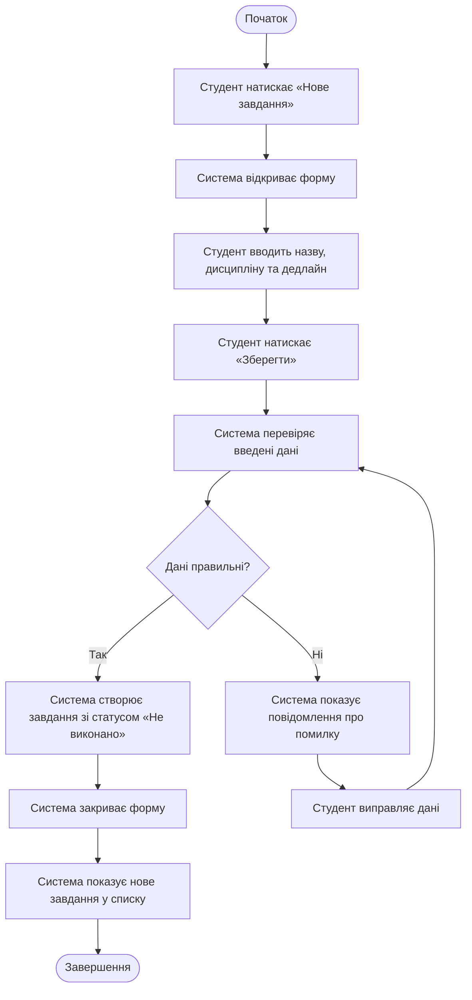

# Activity-діаграма ключового процесу

## Загальна інформація

**Назва продукту:** Student Task Manager.

**Процес:** Створити навчальне завдання.

**Основний актор:** студент.

**Пов’язаний use case:** UC-01. Створити навчальне завдання.

**Пов’язана вимога:** FR-01. Створення навчального завдання.

**Мета процесу:** додати нове навчальне завдання до особистого списку із назвою, дисципліною, дедлайном і початковим статусом «Не виконано».

## Activity-діаграма

## Короткий опис

Діаграма описує процес створення навчального завдання у Student Task Manager. Студент відкриває форму, вводить назву, дисципліну та дедлайн і натискає «Зберегти». Система перевіряє дані: якщо вони правильні, створює завдання зі статусом «Не виконано», закриває форму та показує новий запис у списку. Якщо дані неправильні, система показує повідомлення про помилку, після чого студент виправляє введення, а перевірка повторюється.
