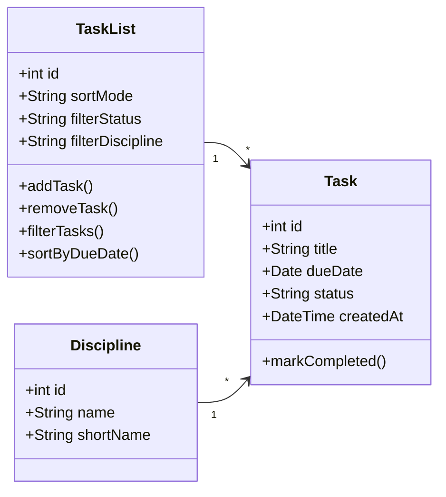

# Спрощена class-діаграма програмного продукту

## Загальна інформація

**Назва продукту:** Student Task Manager.

**Призначення діаграми:** показати основні сутності навчального планувальника, їхні властивості, типи даних і зв’язки в межах MVP.

Модель побудовано на основі опису продукту, вимог, user stories, use-case та activity-діаграми. Основний сценарій — створення навчального завдання, його перегляд і подальше редагування, видалення або позначення виконаним.

У MVP немає облікових записів і спільної роботи кількох користувачів. Тому **Student** залишається зовнішнім актором, а не окремим класом: система веде один особистий список завдань і не зберігає дані авторизації.

## Основні класи

### `TaskList`

Особистий список навчальних завдань. Він є контейнером для записів і зберігає стан фільтрування та сортування списку.

Властивості:

- `id` — унікальний ідентифікатор списку;
- `sortMode` — вибраний спосіб сортування, зокрема за дедлайном;
- `filterStatus` — поточний фільтр за статусом;
- `filterDiscipline` — поточний фільтр за дисципліною.

Основні методи `addTask()`, `removeTask()`, `filterTasks()` і `sortByDueDate()` відповідають документованим діям зі списком і не є окремими сутностями предметної області.

### `Task`

Навчальне завдання, з яким працює студент.

Властивості:

- `id` — унікальний ідентифікатор завдання;
- `title` — назва роботи;
- `dueDate` — дедлайн;
- `status` — стан виконання (`Не виконано` або `Виконано`);
- `createdAt` — дата й час створення запису для його збереження та ідентифікації.

Метод `markCompleted()` відповідає вимозі зміни статусу виконання.

### `Discipline`

Навчальна дисципліна, за якою групуються завдання. Виділення дисципліни в окремий клас дає змогу пов’язати з нею багато завдань і підтримати фільтрування списку.

Властивості:

- `id` — унікальний ідентифікатор дисципліни;
- `name` — повна назва дисципліни;
- `shortName` — коротка назва для компактного відображення та фільтра.

## Mermaid-код class-діаграми

## Пояснення зв’язків і кратності

| Зв’язок | Пояснення |
| --- | --- |
| `TaskList "1" --> "*" Task` | Один особистий список містить багато завдань. Кожен запис `Task` належить цьому списку. |
| `Discipline "1" --> "*" Task` | Одна дисципліна може мати багато завдань. Кожне завдання пов’язане з однією дисципліною. |

Позначення `1` означає один об’єкт, а `*` — багато об’єктів. Так відображено зв’язок «один-до-багатьох» для основного сценарію продукту.

## Відповідність моделі вимогам і MVP

| Клас | Пов’язані матеріали | Як використовується в MVP |
| --- | --- | --- |
| `Task` | FR-01–FR-05, US-01–US-05, UC-01–UC-05 | Зберігає дані завдання, відображає статус, підтримує редагування, видалення та позначення виконання. |
| `Discipline` | FR-01, FR-02, опис основних функцій | Зберігає дисципліну завдання та дає змогу групувати записи за навчальним предметом. |
| `TaskList` | FR-02–FR-05, основний сценарій UC-01, activity-діаграма | Об’єднує завдання в один список і забезпечує його перегляд, фільтрування та сортування. |

Властивості `title`, `dueDate` і `status` безпосередньо відповідають даним, які студент вводить або бачить у списку. Ідентифікатори потрібні для однозначного редагування та видалення конкретного запису. `Student` не включено до діаграми як клас, тому що в поточному MVP користувач є актором, а облікові записи та спільна робота прямо виключені з меж продукту.

## Висновок

Під час практичної роботи визначено три основні сутності Student Task Manager: `TaskList`, `Task` і `Discipline`. Для кожного класу наведено ключові властивості з типами даних, а для необхідних дій — методи. Між класами встановлено два зв’язки «один-до-багатьох» із правильною кратністю. Mermaid-код відповідає структурі MVP, вимогам FR-01–FR-05 і попереднім user stories, use-case та activity-діаграмі.
