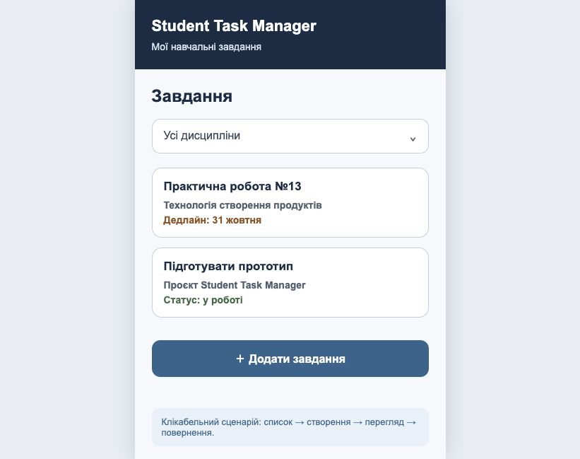

# Клікабельний прототип Student Task Manager

## Призначення

Прототип демонструє основний сценарій створення навчального завдання: користувач відкриває список, переходить до форми, зберігає дані та переглядає створене завдання.

## Екрани

1. Список завдань.
2. Створення завдання.
3. Перегляд завдання.

## Налаштовані переходи

- зі списку до форми створення;
- скасування створення повертає до списку;
- збереження форми відкриває перегляд завдання;
- редагування відкриває форму;
- повернення повертає до списку;
- кнопка «Позначити виконаним» змінює статус у прототипі.

## Початкова точка

Початковий екран — list, екран списку завдань.

## Локальний прототип

Файл [prototype/index.html](../prototype/index.html) відкриває інтерактивну версію без серверної частини. Дані не записуються до бази, а переходи імітують основний користувацький сценарій.

## Перевірка сценарію

1. Відкрити список завдань.
2. Натиснути «Додати завдання».
3. Перевірити форму.
4. Натиснути «Зберегти».
5. Переконатися, що відкрився екран перегляду.
6. Натиснути «Позначити виконаним».
7. Повернутися до списку.

## Figma

У поточному робочому середовищі Figma не підключена до авторизованого акаунта, тому локальна версія прототипу та SVG-ескізи підготовлені як перевірений імпортний матеріал. Після відкриття Figma екрани можна перенести у фрейми 390 × 844 px, налаштувати ті самі переходи та вставити доступне посилання в цей файл і README.
