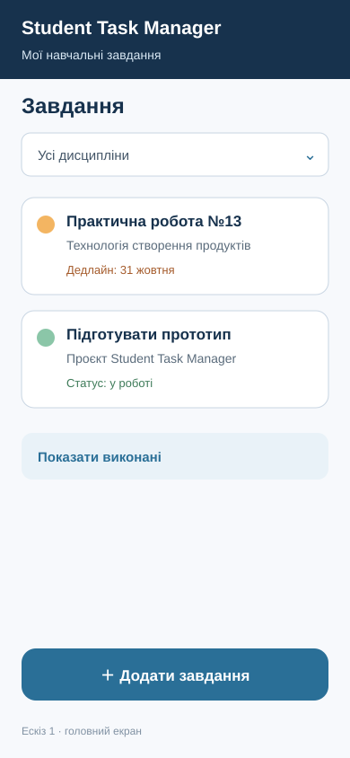
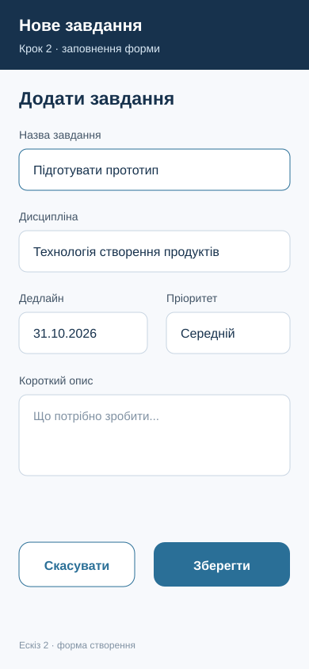
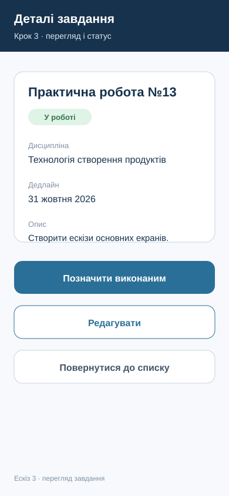

# Ескізи основних екранів

## Назва програмного продукту

Student Task Manager

## Основний сценарій

Користувач відкриває список навчальних завдань, додає нове завдання, зберігає його та переглядає детальну інформацію.

## Перелік екранів

1. Список завдань.
2. Створення завдання.
3. Перегляд завдання.

## Екран 1 Список завдань

Призначення: показати всі актуальні навчальні завдання, дисципліну, дедлайн і статус.

Основні елементи:

- заголовок продукту;
- фільтр за дисципліною;
- картки завдань;
- дедлайн і статус;
- кнопка «Додати завдання»;
- дія «Показати виконані».

Основна дія: перехід до форми створення нового завдання.

## Екран 2 Створення завдання

Призначення: ввести дані нового завдання.

Основні елементи:

- поле назви;
- поле дисципліни;
- поле дедлайну;
- поле пріоритету;
- поле короткого опису;
- кнопки «Скасувати» і «Зберегти».

Основна дія: після натискання «Зберегти» відкривається екран перегляду створеного завдання.

## Екран 3 Перегляд завдання

Призначення: показати повну інформацію про завдання та дозволити змінити його стан.

Основні елементи:

- назва, дисципліна, дедлайн і опис;
- індикатор статусу;
- кнопка «Позначити виконаним»;
- кнопка «Редагувати»;
- кнопка «Повернутися до списку».

## Схема переходів

Список завдань → Додати завдання → Створення завдання → Зберегти → Перегляд завдання.

Створення завдання → Скасувати → Список завдань.

Перегляд завдання → Повернутися до списку → Список завдань.

Перегляд завдання → Редагувати → Створення завдання.

## Результат

Ескізи охоплюють один завершений сценарій: від списку завдань до створення та перегляду запису. На кожному екрані позначено основні елементи керування, а переходи мають зрозумілі назви.
