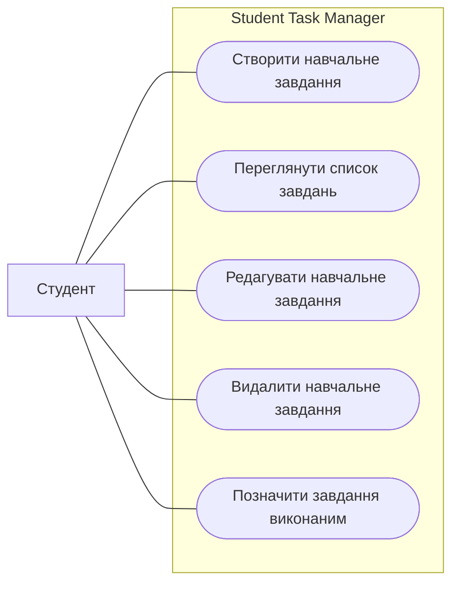

# Use-case модель програмного продукту

## Загальна інформація

**Назва продукту:** Student Task Manager.

**Основний актор:** студент.

**Додаткові актори:** відсутні. У межах MVP продукт призначений для ведення особистого списку навчальних завдань одним студентом.

## Опис актора

**Студент** — основний актор, який додає власні навчальні завдання, переглядає список, редагує та видаляє записи й позначає виконані роботи.

## Основні випадки використання

1. **UC-01. Створити навчальне завдання** — додати назву, дисципліну та дедлайн до особистого списку.
2. **UC-02. Переглянути список завдань** — побачити назву, дисципліну, дедлайн і статус кожного запису.
3. **UC-03. Редагувати навчальне завдання** — змінити дані вже створеного запису.
4. **UC-04. Видалити навчальне завдання** — прибрати непотрібний запис після підтвердження.
5. **UC-05. Позначити завдання виконаним** — змінити статус завершеної роботи.

## Межа програмної системи

Межа системи має назву **Student Task Manager**. Усі п’ять випадків використання виконуються всередині цієї межі. Студент розташований поза межею, оскільки є зовнішнім користувачем, який взаємодіє з продуктом.

## Use-case діаграма

## Відповідність попереднім матеріалам

| Випадок використання | User story | Функціональна вимога | Функція MVP |
| --- | --- | --- | --- |
| UC-01. Створити навчальне завдання | US-01 | FR-01 | Створення навчального завдання |
| UC-02. Переглянути список завдань | US-02 | FR-02 | Перегляд списку завдань |
| UC-03. Редагувати навчальне завдання | US-03 | FR-03 | Редагування завдання |
| UC-04. Видалити навчальне завдання | US-04 | FR-04 | Видалення завдання |
| UC-05. Позначити завдання виконаним | US-05 | FR-05 | Зміна статусу виконання |

Діаграма містить лише функції, які входять до MVP та мають відповідні user stories і функціональні вимоги. Додаткових ролей, авторизації та зовнішніх сервісів у поточній версії немає.

## Основний сценарій

### UC-01. Створити навчальне завдання

**Мета:** додати нове навчальне завдання до особистого списку та зберегти його дедлайн.

**Основний актор:** студент.

**Передумова:** застосунок відкрито, студент перебуває на сторінці зі списком завдань.

**Тригер:** студент натискає кнопку «Нове завдання».

**Основний сценарій:**

1. Студент натискає кнопку «Нове завдання».
2. Система відкриває форму створення завдання з полями назви, дисципліни та дедлайну.
3. Студент вводить назву, указує дисципліну та вибирає дедлайн.
4. Студент натискає кнопку «Зберегти».
5. Система перевіряє заповнені дані.
6. Система створює завдання зі статусом «Не виконано».
7. Система закриває форму та повертає студента до списку.
8. Система відображає новий запис із назвою, дисципліною, дедлайном і статусом.

**Післяумова:** нове завдання збережено та відображено у списку навчальних робіт.

## Висновок

Для Student Task Manager визначено студента основним актором і позначено межу системи. За допомогою Mermaid створено діаграму з п’ятьма випадками використання, кожен із яких пов’язаний з актором, user story та функціональною вимогою. Для основного сценарію створення завдання описано мету, передумову, тригер, вісім послідовних кроків і післяумову.
